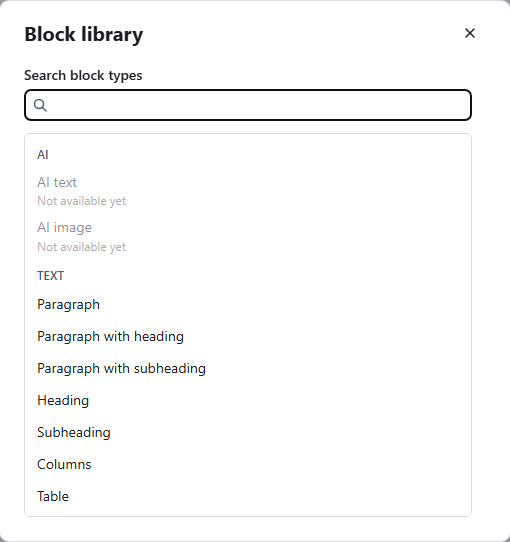

# Working with blocks

[User guide](README.md) › Working with blocks

A lesson is a scroll of **blocks**. Each block is one piece: a paragraph, a picture, a list, a
question, a button. This page covers what every block has in common. [Block types](block-types.md)
lists every type and its own settings.

## Add a block

- **The bar at the end of the lesson** adds a block at the end in one press: **Paragraph with
  heading**, **Labelled image**, **Process**, **Flashcard grid** or **Continue**. **All blocks**
  opens the block library.
- **The + buttons**: **Insert a block at the start** sits above the first block, and **Insert a
  block below …** under each block. Both open the block library at that place.

The new block comes with sample text that says what goes there. Type over it.

## The block library

The library lists every block type, grouped by kind: Text, Statement, Quote, List, Image, Gallery,
Multimedia, Interactive, Knowledge check and Divider, with the types still to come.

- Type in **Search block types** to narrow the list, then **Tab** into it, the **arrow keys** to a
  type and **Enter** (or click it) to add it.
- Types marked **Not available yet** come in later versions ([What 0.1 does not do yet](limits.md)).
- After you copy blocks, the library also offers **Paste N blocks here**.

## A block's row

Each block shows, from top to bottom:

- **Block type**: the block's type. Most blocks can switch here to a related type of the same
  kind, and the content stays: a **Paragraph** becomes a **Paragraph with heading**, a **Numbered
  list** a **Checklist**, **Tabs** an **Accordion**, a **Flashcard grid** a **Flashcard stack**.
  (Questions switch with **Question type** instead.)
- **Can be required**: shown on blocks that learners must finish in some way, which a continue
  block can wait for ([Continue blocks](navigation.md#continue-blocks)).
- The **block tools** (icons; each shows its name when you point at it or move to it):

  | Tool | What it does |
  |---|---|
  | **Style** (drop) | Background, text colour and accent colour (below) |
  | **Format** | Spacing, width, animation and the block's own options (below) |
  | **Narration** (speaker) | An audio track read over the block (below) |
  | **Move up**, **Move down** | Move the block one place |
  | **Duplicate** | Adds a copy right below |
  | **Delete** | Deletes the block; a notice offers **Undo** |
  | **More actions** (**…**) | **Copy**, **Paste below**, **Insert a block below** and **Copy link to block** |

- The block's content, which you edit in place.
- **As learners see it**: the block drawn by the course player itself, updated as you type.

To move a block further, drag it by its handle, or use the keyboard: move to the handle, press
**Enter**, use the **arrow keys**, then **Enter** (**Escape** puts it back).

## Style

**Style** sets how the block's background looks:

- **Background**: **Light** (the default), **Gray**, **Theme colour**, **Theme tint**, **Dark**,
  **Black**, **Custom colour** or **Image**.
  - With **Custom colour**, type the **Colour** as `#` and six digits or letters a to f (such as
    `#2f6f9f`), and pick the **Text colour**: **Automatic, always readable**, **Light** or **Dark**.
  - With **Image**, choose a picture, and an **Overlay** over it (**Dark, with light text**, the
    default, or **Light, with dark text**) with its **Overlay strength** (50 % by default).
- **Keep cards white** (blocks with answer cards or other cards, on by default): the cards stay
  white on the block's colour.
- **Accent colour**: the colour of the block's links, buttons and marks. Leave it empty to use the
  course's colour. If it would be hard to read on the block's background, the editor says so and
  learners see the course colour instead.

## Format

**Format** holds:

- **Padding size**: **Small**, **Medium** (the default) or **Large** space above and below the
  block. **More padding options** sets **Top padding** and **Bottom padding** from 0 to 200 pixels,
  together (**Link top and bottom**, on by default) or apart.
- **Content width**: **Narrow**, **Full column** (the default), **Wide** or **Full width**.
- **Fade in when scrolled into view**: on by default for every block except text blocks. Learners
  who ask their device for less motion see no animation.
- In a microlearning: **Show with the next block in one step**, for a microlearning that moves in
  steps ([Navigation](navigation.md#a-microlearning)).
- Then the block's own options ([Block types](block-types.md)).

## Narration

Every block except headings and subheadings can carry narration: an audio file that learners can
play with the block.

1. Choose **Narration**, then **Add narration audio** (or drop an audio file on it).
2. Type its **Transcript**, so learners who cannot hear it can read it.
3. Pick where the **Narration player** sits: **At the top of the block** or **At the bottom of the
   block** (the default).

**Remove the narration** takes it off again. The tool reads **Narration (on)** while a block has
narration.

## Copy and paste

- **Copy** a block from **More actions**, or press **Ctrl+C** while the block's row has focus (the
  row itself, not a field in it).
- **Paste below** a block from its **More actions**, or press **Ctrl+V** while its row has focus.
  The library and the bar at the end of the lesson also offer **Paste N blocks here**.

You can paste into any lesson of this course, or of another course you open later, as long as the
app stays open. Pictures and media come with the blocks.

**Copy link to block** copies a link to that block. Paste it as the address of a link in any text
of the same course, and learners who follow it go straight to the block.

## Manage blocks

**Manage blocks**, above the lesson's blocks, lists every block of the lesson to pick from: click
or press **Space** on each, or **Select all**. For the picked blocks:

- drag a handle to move them all together;
- **Style**: one background for all of them;
- **Copy**, to paste elsewhere;
- **Copy to a lesson…**: adds them at the end of another lesson of this course;
- **Copy to another course…**: adds them at the end of the last lesson of another course or
  microlearning in your list, with their media; a notice offers **Open that lesson**;
- **Duplicate**: adds copies below the selection;
- **Delete**, after a question. **Undo** brings them back.

Each of these is one step to undo.

## Formatted text

Paragraphs, descriptions, questions, feedback and most other longer texts are formatted text. While
you type in one, its tools appear:

| Tool | Keys |
|---|---|
| **Text style**: **Normal text**, or **Heading 2** to **Heading 5** | |
| **Bold** | Ctrl+B |
| **Italic** | Ctrl+I |
| **Underline** | Ctrl+U |
| **Strikethrough** | Ctrl+Shift+X |
| **Subscript**, **Superscript** | |
| **Bulleted list**, **Numbered list** | |
| **Link** | Ctrl+K |
| **Clear formatting** | |

**Alt+F10** moves from the text to its tools, and **Escape** back to the text.

**Link** asks for a **Web or email address** (starting with `https://`, `http://` or `mailto:`, or a
link copied from a block), or **Find a lesson** to link to a lesson or quiz by its title. **Add
link** sets it; **Remove link** takes it off.

Text you paste from elsewhere keeps its bold, italics, lists and links, and loses fonts, sizes and
colours, so it matches the course's theme.
