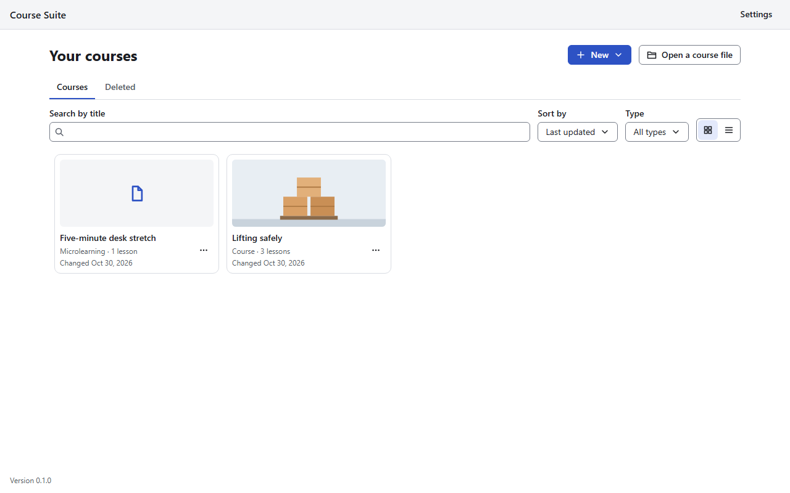

# Your courses

[User guide](README.md) › Your courses

When Course Suite starts, it shows **Your courses**: a card for each course you have made or
opened. The first time, the list is empty and offers **Blank course**.

## Course files

Each course is one file ending in **`.crs`**. It holds the whole course: its text, settings,
pictures, audio, video and fonts. You choose where it goes when you create the course, for example
in your **Documents** folder. You can copy, back up or send a `.crs` file like any other file, and
open it on another computer with Course Suite.

While you edit, the app keeps your recent changes in a hidden folder next to the file, named
`.<file name>.autosave` (for example `.Lifting safely.crs.autosave`). It uses that folder to give
your work back after a crash. Leave it where it is: the app removes it each time you save, and when
you close the course without saving.

## Make a course

Choose **New**, then one of:

| Choice | What you get |
|---|---|
| **Blank course** | An empty course: a cover page and an outline with no lessons yet |
| **Blank microlearning** | An empty short course of one lesson, with no outline and no quizzes |
| **From a template…** | **Starter course** (two sections: an introduction, then lessons to explain an idea, teach steps and sum up) or **One idea, explained** (a microlearning with one idea, an example and a picture). Every block holds placeholder text that says what to write there |

Then:

1. Type the **Title** (up to 100 characters) and choose **Create** (for a template, pick it and
   choose **Use template** first).
2. Choose where to save the course file. The name suggested is the title, such as
   `Lifting safely.crs`.
3. The course opens in the editor ([The course editor](editor.md)).

## Open a course file

Choose **Open a course file** and pick a `.crs` file, for example one a colleague sent you. It is
added to your list. Choosing a card opens that course.

A file that is damaged, is not a course file, or was made by a newer version of Course Suite is
not opened, and is left unchanged; the message says why, with **Details**.

## Find a course

- **Search by title**: the list narrows as you type. **Escape** clears the search.
- **Sort by**: **Last updated**, **Date created** or **Title A–Z**. The app remembers your choice.
- **Type**: **All types**, **Course** or **Microlearning**.
- **View**: **Grid** (cards) or **List** (rows). The app remembers your choice.

A page holds 16 courses; use the page buttons below the list to see more.

Each card shows the course's cover picture (or a plain one), its title, whether it is a course or
a microlearning, its number of lessons and when it last changed. A card that says **File not
found** points to a file that was moved, renamed or deleted: open the file again from its new
place with **Open a course file**, and remove the old card with **Remove from list**.

## Duplicate, rename and delete

Each card has an **Actions** button (**…**):

- **Duplicate**: type a name for the copy (**Copy of …** is suggested) and choose where to save it.
  The copy is a new course file with everything in it, pictures and video included.
- **Rename**: changes the course's title, inside the file. The file keeps its name; rename it in
  File Explorer if you want to, then open it again with **Open a course file**.
- **Delete**: moves the course to the **Deleted** list. A notice offers **Undo**.

**Deleting never deletes the file.** The app removes courses only from its list; the `.crs` file
stays on your computer until you delete it yourself in File Explorer.

The **Deleted** tab lists the courses you deleted. For each: **Restore** puts it back in your
list, **Remove from list** forgets it. **Empty Deleted** removes them all from the list, after
asking. Their files stay on your computer.

To act on several courses at once, tick the box on each card (or press **Ctrl+A** for every course
on the page). A bar appears with **Delete** (in **Deleted**: **Restore** and **Remove from list**)
and **Clear selection**. Changing page clears the selection.

## Saving

The top bar of the editor says where your work stands: **Saved**, **Unsaved changes**,
**Saving…**, or **Could not save** with the reason. The window's title starts with `*` while there
are unsaved changes.

- **Save** (the disk button, or **Ctrl+S**) writes the course file. Ctrl+S saves even while you are
  typing in a text field.
- **Save as** (**Ctrl+Shift+S**) saves the course as a new file and goes on with that one. The old
  file stays as it was at its last save.
- **Autosave**: about three seconds after each change, the app keeps a copy in the autosave folder,
  so a crash or power cut loses at most a few seconds of work. Autosave does **not** change the
  course file itself: only **Save** does.

When you leave a course (**Back to your courses**, or closing the window) with unsaved changes, the
app asks **Save changes to …?**: **Save**, **Don't save** (your changes since the last save are
dropped) or **Cancel** (you stay in the course).

## Getting your work back after a crash

If the app or the computer stopped while a course had unsaved changes, opening that course again
asks **Recover unsaved changes?**:

- **Recover changes** opens the course with the changes the autosave kept. Save to keep them in the
  file.
- **Open the saved file** opens the course as it was last saved, and drops the autosaved changes.
- **Cancel** opens nothing, and asks again next time.

If the course file itself cannot be read but an autosaved copy can, the app says so and offers the
copy.

When you duplicate or rename such a course, or copy lessons or blocks into it, the app first asks
which version to use: **Use the recovered changes** or **Use the saved file**.

## Settings

**Settings**, at the top right of **Your courses**, holds the switch for automatic update checks and
**Check now** ([Updates](updates.md)).
