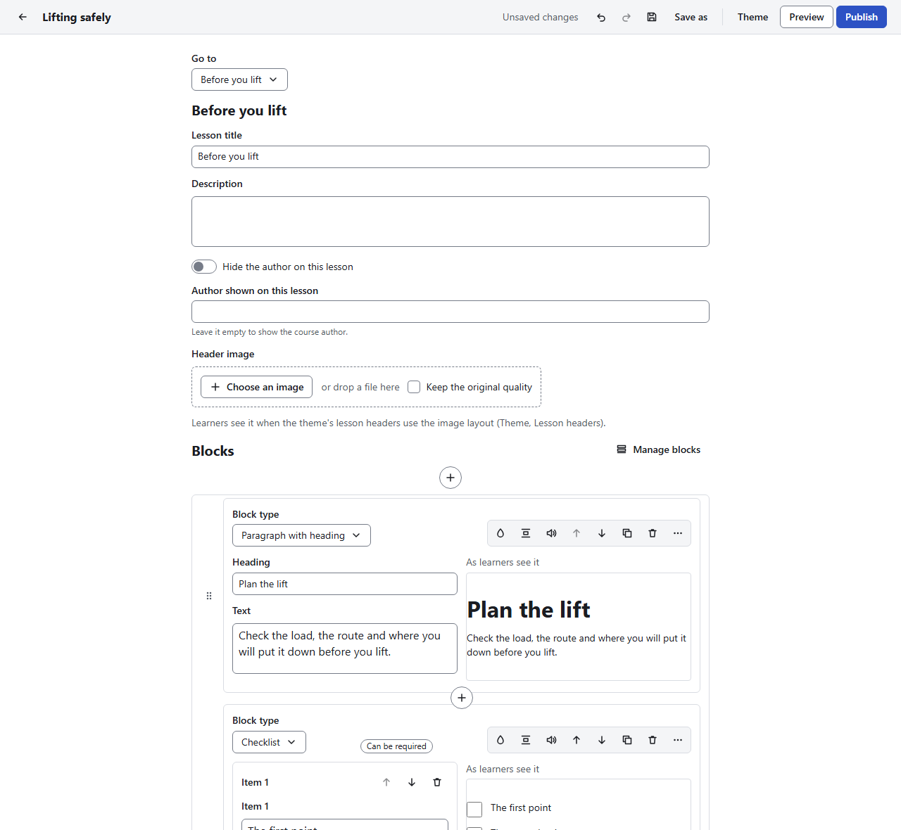

# The course editor

[User guide](README.md) › The course editor

Opening a course shows its **overview**: the course's own details, then its outline. Opening a
lesson from the outline shows that lesson's blocks.

## The top bar

From left to right:

| Control | What it does |
|---|---|
| **←** (Back to your courses) | Closes the course and goes back to **Your courses**, asking first if there are unsaved changes |
| Course title | The course you are editing |
| Save state | **Saved**, **Unsaved changes**, **Saving…** or **Could not save** ([Saving](courses.md#saving)) |
| **Undo** and **Redo** (curved arrows) | Take back the last change, or do it again |
| **Save** (disk) | Saves the course file (**Ctrl+S**) |
| **Save as** | Saves the course as a new file (**Ctrl+Shift+S**) |
| **Theme** | Colours, fonts, cover page, lesson headers and navigation ([Theme and fonts](theme.md)) |
| **Preview** | The course as learners see it ([Preview](preview.md)) |
| **Publish** | Output settings and export ([Publish and export](publish.md)) |

## The course overview

| Field | What it is |
|---|---|
| **Course title** | Up to 100 characters. Shown on the cover page and in the menu |
| **Source language** | The language the course is written in, as a code such as `en-US` or `fr-CA` (default `en-US`) |
| **Author shown to learners** | Shown on the cover and the lessons. Leave it empty to hide the author |
| **Description** | Formatted text shown on the cover page, above the outline |
| **Cover image** | The picture of the cover page and of the course's card in **Your courses** ([Pictures](media.md#pictures)) |
| **Outline** | The course's lessons, quizzes and section headers (below) |

A **microlearning** has no outline: its overview shows the blocks of its one lesson instead.

Every text field keeps what you type as you go: there is no button to confirm it. **Escape** while
typing takes back what you typed since you entered the field.

## The outline

### Add lessons, quizzes and section headers

Under **Outline**, in **New lesson or section**, type a title and:

- press **Enter** to add a **lesson**;
- press **Shift+Enter** to add a **section header**, which groups the lessons below it.

Or choose **Add**, then **Lesson**, **Quiz**, **Section header** or **Lesson from a template…**.
The lesson templates are **Introduction**, **Explain an idea**, **Teach the steps** and
**Summary**; each holds blocks with placeholder text that says what to write.

A course needs at least one lesson before learners can take it.

### Each row of the outline

- the **drag handle**, to move the row;
- an icon for the kind of row, once a lesson or quiz has content;
- the title, which you can change in place;
- **Open**, for a lesson or quiz;
- a **bin** (**Delete**), for a section header or an empty lesson;
- **Actions** (**…**): **Open**, **Duplicate** (the copy goes right below), **Copy to another
  course…**, **Add lesson below**, **Add quiz below**, **Add section header below**, **Move up**,
  **Move down** and **Delete**.

A section header also has a button to fold its lessons away and show them again. Moving a section
header moves its lessons with it.

### Move rows

- With the mouse: drag a row by its handle.
- With the keyboard: move to the handle, press **Enter**, use the **arrow keys**, then **Enter** to
  drop it there (**Escape** cancels).
- Or use **Move up** and **Move down** in the row's **Actions**.

### Delete

Deleting a lesson, quiz or section header shows a notice with **Undo** for 8 seconds. Buttons in
other lessons that lead to a deleted lesson are deleted with it; **Undo** brings them back too.

### Copy a lesson to another course

**Actions**, **Copy to another course…** lists your other courses. Pick one: the lesson is added at
the end of its outline, with its pictures and media, and that course file is saved. A notice offers
**Open that course**.

- A microlearning holds one lesson and no quiz, so it is not offered.
- Buttons that lead to other lessons, and a quiz's skip-ahead, are not copied, as those lessons are
  not in the other course.

## A lesson

**Open** a lesson to edit it. At the top:

| Field | What it is |
|---|---|
| **Go to** | Switches to another lesson or quiz, or back to the **Course overview** |
| **Lesson title** | The lesson's title in the menu and its header |
| **Description** | Formatted text under the title |
| **Hide the author on this lesson** | Hides the author on this lesson only |
| **Author shown on this lesson** | Leave it empty to show the course's author |
| **Header image** | A picture for this lesson's header. Learners see it only when the theme's **Lesson headers** have **Image** as their **Header background** |

Below come the lesson's **Blocks** ([Working with blocks](blocks.md)). A quiz shows its questions
instead ([Knowledge checks and quizzes](questions.md)).

## Undo and redo

- **Undo**: the top bar's button, or **Ctrl+Z**.
- **Redo**: the top bar's button, **Ctrl+Y** or **Ctrl+Shift+Z**.

These keys work outside text fields. Each change is one step: one block added, one setting
changed, one field edited (from entering the field to leaving it), one theme section saved.

The undo history belongs to the screen you are on: opening another lesson, or going back to the
overview, starts a new history. Saving does not clear it.
