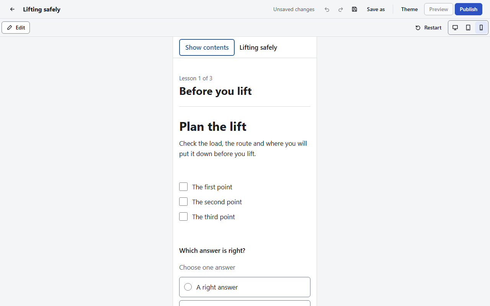

# Preview

[User guide](README.md) › Preview

**Preview**, in the top bar, shows the course as learners will see it, in the same player that
your exported packages use. From a lesson, it opens at that lesson; from the course overview, at the
cover page.

| Control | What it does |
|---|---|
| **Computer**, **Tablet**, **Phone** | The width the course is shown at: the full window, 768 pixels or 375 pixels wide |
| **Restart** | Forgets what you did in the preview and starts the course again, as a new learner would |
| **Edit** | Goes back to the editor, at the lesson the preview is showing |

In the preview you can do everything a learner can: open the menu, answer questions, take quizzes,
press continue buttons and play audio and video. Your answers and progress there are not saved in
the course and are not sent anywhere.

The **Theme** panel shows the same preview beside its settings, so you see each change as you make
it.

Things to know:

- A web embed (YouTube, Vimeo, Loom or Dailymotion) shows where the video will play, but does not
  load it in the preview. Learners' browsers load it from the site when they play it.
- Very large videos make the preview slower to update, as it is given every media file again after
  each change.
