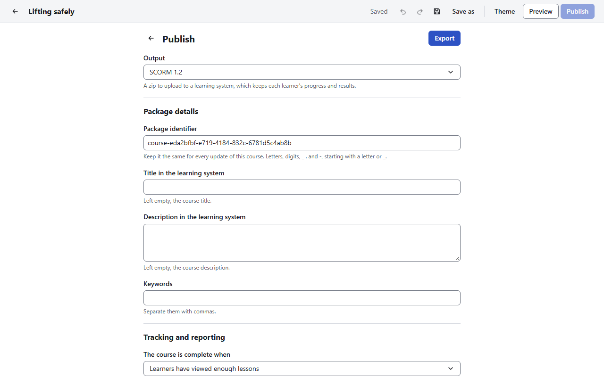

# Publish and export

[User guide](README.md) › Publish and export

To give a course to learners, you **export** it as a zip **package**, then upload that zip to your
learning system or put it on a web server. Choose **Publish** in the top bar; **Back to the course** (the arrow) goes back to the course
overview.

The settings are saved in the course, so they are filled in the next time you export. Each change
is one step to undo.

## Pick the output

**Output** is the kind of package:

| Output | Choose it when | Where it goes |
|---|---|---|
| **SCORM 1.2** (default) | Your learning system takes SCORM packages, and you are not sure which kind. Almost every learning system takes SCORM 1.2 | Upload the zip, as it is, where your learning system adds a SCORM package |
| **SCORM 2004 (4th edition)** | Your learning system takes SCORM 2004. It records whether a learner completed the course and whether they passed as two separate results | Upload the zip where your learning system adds a SCORM package |
| **xAPI** | Your learning system, or your learning record store, asks for xAPI packages | Upload the zip where it adds an xAPI package |
| **cmi5** | Your learning system takes cmi5 course packages | Upload the zip where it adds a cmi5 course |
| **Web package** | You want the course on a website or an intranet, or in a folder, without a learning system. **It keeps no progress and sends no results** | Unzip it and put the folder on any web server, or open `index.html` from the folder |

Do not unzip a package before you upload it to a learning system: it expects the zip.

The project tests its packages in open-source learning systems (Moodle for SCORM 1.2, ILIAS for
SCORM 2004), an open-source learning record store for xAPI and the official cmi5 test suite. Other
learning systems are not tested yet.

## Settings for learning systems

These settings show for SCORM 1.2, SCORM 2004, xAPI and cmi5.

### Package details

| Setting | What it is |
|---|---|
| **Package identifier** | How the learning system recognises this course. **Keep it the same for every update of this course**, so learners keep their progress. For SCORM: letters, digits, `_`, `.` and `-`, starting with a letter or `_`. For xAPI and cmi5: an address, such as `https://example.org/courses/safety`. One is filled in for you. A wrong one is marked, and stops the export until it is fixed |
| **Title in the learning system** | Left empty, the course title |
| **Description in the learning system** | Left empty, the course description |
| **Keywords** | Separated by commas |

### Tracking and reporting

**The course is complete when**:

- **Learners have viewed enough lessons**: set **Lessons to view**, from 1 to 100 % (100 % by
  default); or
- **Learners finish a quiz**: pick the **Quiz to track**. Learners pass with the passing score set
  in that quiz's settings. Offered once the course has a quiz.

A microlearning is complete once the learner has viewed all of it.

**What the learning system records**, for a finished course and for one not finished yet:
**Passed, or incomplete** (default), **Passed, or failed**, **Completed, or incomplete** or
**Completed, or failed**. Ask your learning system's administrator which one your reports expect.

For **cmi5**, **The learning system counts the course as done when it is**: **Completed**,
**Passed**, **Completed and passed**, **Completed or passed**, or **Opened (no requirement)**. A rule
that needs a pass, in a course where no quiz decides a pass, is marked and stops the export.

### Options and advanced

| Setting | Default | What it does |
|---|---|---|
| **Exit course link** | Off | Adds a button to the course menu that ends the visit |
| **Hide the cover page** | Off | The course opens at its first lesson. This is the same switch as the theme's **Skip the cover page** |
| **Reset learner progress on update** | Off | Learners who started an earlier version begin again at their next visit; their quiz results stay. Use it when you removed lessons. The app asks before turning it on |
| **Open only from a learning system** | On | Opened anywhere else, the course shows a message instead. Opening it from a folder on your own computer still works, for checking |

## Settings for a web package

A web package has one setting: **Hide the cover page**, so that the package opens at its first
lesson. It is kept apart from the learning system setting: learning system packages and the preview
follow the theme's cover setting.

## Before you export

**Before you export** shows:

- for learning system outputs, how much of the learning system's storage for each learner's
  progress the course needs, against the limit of the output (4,096 characters for SCORM 1.2). If
  the course needs more, some progress will not be saved; split the course, or choose SCORM 2004;
- what learners would meet in the package: an empty lesson or quiz, a link to a lesson or block
  that is gone, a picture without alt text, or a file missing from the course.

## Export

1. Choose **Export**.
2. If there is something to look at, **Check the course before exporting** lists it. Choose **Go
   back and edit**, or **Export anyway**. A missing file stops the export: add it to the course
   again first.
3. Choose where to save the zip. The name suggested is the course title and the output, such as
   `Lifting-safely-scorm12.zip`.
4. The package is built in the background, with its progress. **Keep working** lets you go on
   editing meanwhile; **Cancel export** stops it, and nothing is saved.
5. **Package saved** says where the zip is and its size, with what to do next: **Upload the zip to
   your learning system**, or for a web package, unzip it and open `index.html`, or put the folder
   on any web server. Any warnings follow under **Before you share it:**.

Each export gets a new version number, which the learning system uses to tell updates apart. The
course keeps that number and the settings it was exported with, so it shows **Unsaved changes**
after an export: save it. Exporting adds nothing to undo.

## Updating a course that learners already have

1. Edit the course, and export it again with the same **Package identifier**.
2. In your learning system, replace the package of the existing course with the new zip (rather
   than adding a new course), so learners keep their place and results.
3. If you removed lessons, consider **Reset learner progress on update**.

Packages hold everything they need: fonts, pictures, media and the player. They connect to nothing
but the learning system that opened them, apart from any web embeds you added, which load from
their site when a learner plays them.
