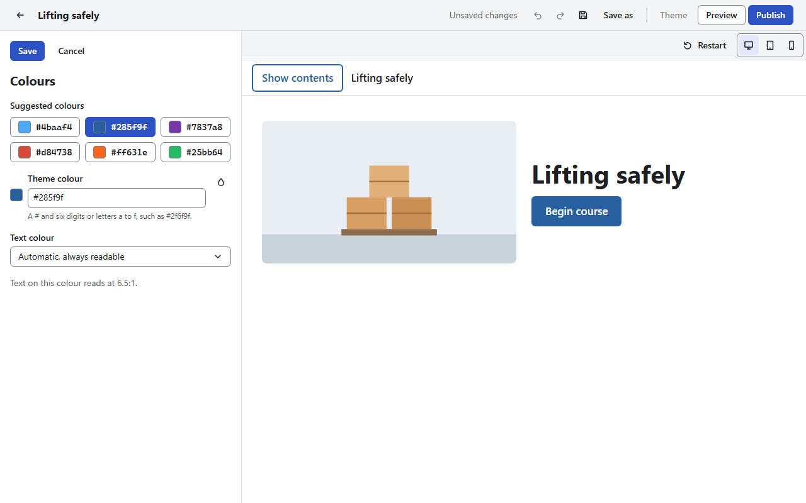

# Theme and fonts

[User guide](README.md) › Theme and fonts

The **theme** is the look of the whole course: its colour, fonts, cover page, lesson headers,
navigation and block corners. Choose **Theme** in the top bar.

The panel lists its sections, each with its current value. Choose one to change it. The course
preview beside the panel shows each choice as you make it; use its device buttons to try the
course at tablet or phone width. **Save** keeps the section's changes (one step to undo), and
**Cancel** drops them. **Back to the course** closes the panel and shows the course overview.

## Layout style

**Classic** (picture beside the title, plain lesson headers), **Rounded** (softer picture corners,
tinted lesson headers) or **Bold** (title over the picture, lesson headers in the theme colour). A
layout style sets only the cover and lesson header layouts: colours, fonts and navigation stay as
they are.

## Cover page

The cover is the first page learners see. Its picture is the **Cover image** of the course
overview ([The course editor](editor.md#the-course-overview)).

| Setting | What it does |
|---|---|
| **Cover layout** | **Picture on the left**, **Picture on the right**, **Title over the picture** or **No picture** |
| **Overlay colour**, **Overlay strength** | With **Title over the picture**: a **Dark**, **Light** or **Theme colour** layer between the picture and the title. If the title could be hard to read over light parts of the picture, the panel says so and offers **Use N%** |
| **Crop the cover picture** | Shows only part of the picture (below) |
| **Logo** | A picture shown on the cover, with its alternative text, a crop, a **Logo size** (**Small (1x)**, **Medium (1.5x)**, **Large (2x)**) and **Square logo** (cut to a square from its middle) |
| **Start button** | On by default. Without it, learners start from the course outline |
| **Show authors** | On by default. Off hides the author on the cover and on every lesson |
| **Skip the cover page** | Published courses open at the first lesson, or where the learner stopped |

**Crop**: in the crop window, set the **Left edge**, **Top edge**, **Width** and **Height**, or
choose **Show the whole picture**. Drawings (SVG) and animations (GIF) cannot be cropped.

## Navigation

The course menu, lessons in order, search and the previous and next buttons: see [Continue blocks
and navigation](navigation.md#navigation-of-a-course).

## Lesson headers

The header at the top of each lesson (courses only):

| Setting | What it does |
|---|---|
| **Hide lesson headers** | Hides the lesson count, title and author. Screen readers still read the title |
| **Header background** | **Light** (default), **Gray**, **Theme colour**, **Theme tint**, **Dark**, **Black**, **Custom colour** (with its text colour) or **Image** |
| **Header picture** | With **Image**: a picture, its alternative text and crop, under a dark, light or theme-coloured layer (dark at 60 % at first). A lesson's own **Header image** shows instead of this one |
| **Header height** | **Small**, **Medium** (default) or **Large** |
| **Lesson count label** | The lesson's number of the total, on or off |
| **Author** | The author, on or off |

## Colours

- **Suggested colours**: six to start from, or type a **Theme colour** (`#` and six digits or
  letters a to f). **Pick a colour from the screen** takes one from anywhere on the screen.
- **Text colour**: the colour of text on the theme colour: **Automatic, always readable**, **Light**
  or **Dark**.

The panel checks every colour as you pick it, so the course stays readable:

- text needs a contrast of at least 4.5 to 1; the panel shows the contrast of text on your colour,
  and warns when it is lower;
- links and buttons on white use the nearest shade of your colour that reads at 4.5 to 1. The panel
  names that shade and offers **Use …** to make it the theme colour.

## Fonts

**Recommended pairings** offers **Device fonts** (the default) and eight pairings of a heading
font and a body font.

- **Device fonts**: each learner sees their own device's fonts. The course carries no font files,
  so it loads fastest.
- The bundled fonts are Crimson Pro, Inter, Literata, Montserrat, Noto Sans, Noto Serif, Open Sans
  and Work Sans, all under the SIL Open Font License. A course carries only the fonts it uses.

**Mix fonts** picks each font yourself: the **Heading font**, the **Body font** and the **Interface
font** (menus, buttons and labels; or **Same as the heading font**), from the device fonts, the
**Bundled fonts** and **Your fonts**.

### Your own fonts

1. In **Mix fonts**, choose **Add a font**.
2. Type the **Font name**, and choose a WOFF or WOFF2 file for the **Regular** face (required),
   and for **Bold** and **Italic** if you have them. Each file can be up to 5 MB.
3. Choose **Save**.

Only add fonts you have the right to use and share: every course you publish with a font carries
its files.

Your fonts are kept in the app, not in one course, so every course can use them. **Edit font**
changes a font in every course that uses it. **Delete** cannot be undone; courses that used the font
show the device's font instead.

## Blocks

| Setting | Default | What it does |
|---|---|---|
| **Fade blocks in as they scroll into view** | On | A block can turn its own animation off in its **Format** menu. Learners who ask their device for less motion see none |
| **Block corners** | **Rounded** | Or **Square** |
| **Button corners** | **Rounded** | Or **Square** |
